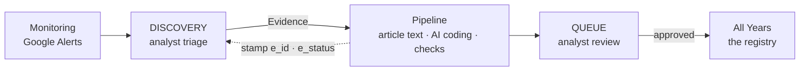

# CSDB · Cocaine Seizures Database — Methods

**Pilot booklet · v0.1 · 16 November 2026**
InSight Crime · Monitoring and Data Analysis Unit (MAD)
*A sketch of key takeaways, to be expanded into the reference documents of the product.*

---

## 1 · What we monitor

- **The phenomenon:** the cocaine supply chain as it becomes visible through **state action** — interdictions, lab destructions, crop eradication — and through **official figures** (production estimates, totals, prices).
- **The unit of record is the event, not the article.** One article can describe several events; several articles can describe the same event.
- **The window:** public reporting (news media, government press releases), captured daily through monitoring alerts and triaged by analysts.
- **The geography:** global, with depth on Latin America, the Caribbean and the routes to Europe, North America, Africa and Asia.

## 2 · What a "seizure" means

- **Reference definition (UNODC):** a lawful action by a law enforcement agency that takes legal control of a controlled substance and places it under the physical custody of national authorities.
- **In the CSDB:** an operation where authorities took possession of a quantity of cocaine (or a cocaine product: base, crack, liquid cocaine, coca leaf).
- **A seizure record proves three things at once:** that trafficking happened, that enforcement acted, and that someone reported it. It proves nothing about what was *not* seized.
- **Boundary cases** (house rules):

| Case | How it is recorded |
|---|---|
| Lab raided or dismantled, destruction not stated | `Seizure` |
| Lab or facility explicitly destroyed | `Destruction of Infrastructure` |
| Coca plants destroyed | `Crop Eradication` |
| Incineration of drugs seized earlier | `Other (explain in Description)` · `Multi-Month` — never a seizure |
| Operation, quarter or year totals | Seizure with a multi-period `time_unit` and `date_1`–`date_2` |
| National production or cultivation figures | `Total Production Estimate` / `Total Crop Cultivation Estimate` |
| Reported street or wholesale prices | `Price` |

## 3 · Why we do it

- **Timeliness.** Official seizure statistics can take up to two years to be compiled and published; open sources report within days, often hours.
- **Context.** Official totals rarely say *how* (concealment, vessel type), *where from / where to* (origin, transit, destination) or *who* (criminal groups). News reports often do.
- **Signals, not totals.** The database is built to detect **changes**: new routes, new concealment methods, new actors, unusual sizes, displacement between countries.
- **Institutional value.** It feeds InSight Crime's investigations, analysis and data services, and gives fieldwork a quantitative backbone.

## 4 · What the data can and cannot say

- **Seizures are not a measure of the market.** They are a function of three things: trafficking flows, enforcement effort and traffickers' countermeasures. A rise can mean more cocaine, more policing, or worse concealment.
- **Media monitoring adds a fourth filter: coverage.** Some countries, languages, outlets and seizure sizes are reported more than others.
- **Read trends with care:** compare like with like (same country, same event type, same `time_unit`), watch for single giant events, and never add totals to the individual seizures they already contain.
- **The database is a sample, not a census.** Absence of records is not absence of trafficking.

## 5 · The data model at a glance

45 columns, grouped by the question they answer:

| Question | Columns | Key rule |
|---|---|---|
| **What** | `event_type`, `drug_type` | Closed vocabularies; one event type per row |
| **When** | `time_unit`, `date_1`, `date_2` (+ `year`, `month`, `day`, `duration`) | `time_unit` errors are the most damaging: a total logged as `Individual` becomes a phantom record seizure |
| **How much** | `quantity`, `quantity_unit` | Bare number; tons → kg is the only conversion; packages are counted, never assumed to be kilos |
| **How** | `modus_operandi`, `sub_modus_operandi` | How the drugs were *transported*, not where they were found |
| **Where** | `region`, `country`, `department/state`, `municipality/port` | The **seizure location only** |
| **Route** | `origin_*`, `transit_1_*`, `transit_2_*`, `destination_1_*`, `destination_2_*` | Only what the article states; origin = where it was produced |
| **Who** | `criminal_group_1–3`, `minor_involved` | Only explicit attributions; "suspected" or "in an area controlled by" is not one |
| **Provenance** | `description`, `source_link`, `source_link2`, `archived_link`, `project_interested`, `uid` | Every row traceable to its source |

## 6 · Ten coding rules

1. **Blank beats guess.** A missing value is information; an invented one is damage.
2. **Only the source.** No outside knowledge, no inference from what "usually" happens.
3. **One row per event.** Separate dates, places or operations are separate rows.
4. **Closed vocabularies.** Exact strings only; never invented, translated or abbreviated.
5. **Seizure place ≠ route.** Location fields hold where it was seized; the route goes in origin / transit / destination.
6. **Origin means production.** Fill it only when stated (for labs, where the lab stood); a seizure in a non-producing country puts that country in transit, not in origin.
7. **Dates are exact or empty.** Year- or month-only dates leave `date_1` empty and the row flagged; no day or month is ever invented.
8. **Publication date as fallback is always flagged** as an approximation.
9. **Totals are never individual events.** Multi-period totals carry a multi-period `time_unit`.
10. **Every row carries its evidence:** the sentence that supports its quantity and date.

## 7 · How a row is made

- **Monitor:** keyword alerts in several languages feed `DISCOVERY` daily.
- **Triage:** analysts tag each alert (`Evidence`, `Discard`, …). Only `Evidence` moves on.
- **Process (Transforming Evidence):** the pipeline reads the article (directly, from the Internet Archive, or as a last resort from the headline, flagged), codes it with Claude under the house rules and the registry's own vocabularies, and checks every row.
- **Review:** rows land in `QUEUE` with flags, the supporting quote and their status (`to_review`, `no_event`, `needs_manual`). Nothing reaches the registry without a person.
- **Trace:** every article has an `e_id`, stamped in `DISCOVERY` and `QUEUE`, with its `e_status`, run id and prompt version.

## 8 · Quality assurance

- **Automatic checks (flag, never fix):** off-vocabulary values, non-numeric quantities, missing or partial dates, 1st-of-month dates, approximated dates, long descriptions, headline-only coding, possible duplicates (within a batch and against the registry).
- **Human review** of every row in `QUEUE` before promotion.
- **Audit trail:** run folders, ledger, versioned prompts, archived copies of sources.
- **Pilot indicators:**

| Measure | Pilot result |
|---|---|
| URLs with usable article text | 80% (October batch, 50 URLs); 74% in the controlled experiment (110 URLs) |
| Articles coded without errors | 49 of 49 |
| Cost | about USD 0.01 per article |
| Events with an approximated date | 25 of 51 — the main weakness to work on |

- **Next:** a gold-standard test set (human-coded articles) to measure event-level and field-level accuracy before scaling claims.

## 9 · Known biases and limits

| Source of bias | Effect | Mitigation |
|---|---|---|
| Media coverage | Over-represents large seizures and well-covered countries and languages | Multilingual alerts; government sources; coverage reports |
| Enforcement | Seizures follow policing priorities | Interpret as interdiction, not supply |
| Re-reporting | The same event in several outlets | Duplicate flags; one row per event |
| Aggregation | Totals mixed with individual events | Strict `time_unit`; separate analyses |
| Precision | Rounded quantities, approximate dates, coarse places | Bare numbers; flags; no invented detail |
| Access | Paywalls, blocked sites, dead links | Archive copies; headline-only rows flagged; no paywall bypass |
| AI coding | Misreadings, invented specifics | Closed vocabularies, evidence quotes, flags, human review |

## 10 · Sourcing and ethics

- Primary and government sources over aggregators.
- No paywall, login or anti-bot circumvention; legitimate alternatives only (archives, wire copy, press releases).
- Every row links to its source; archived copies where available.
- No personal data beyond what the event requires; minors recorded only when explicitly stated.

## 11 · Rules to settle before the reference documents

The pipeline's house rules and the CSDB extraction guide disagree on these points. One rulebook should decide each:

- **Description length:** under 10 words (guide) or under 15 (pipeline)?
- **Multi-drug seizures:** cocaine quantity only (guide) or `All/Unspecified/Multiple` with no quantity (pipeline)?
- **"Combined event":** in the pipeline's list, absent from the guide.
- **Approximations** ("more than 2 tons"): the conservative round figure (guide) — not yet in the pipeline.
- **Incineration, lab raids, maritime locations, destination logic:** in the guide, not yet in the pipeline prompt.
- **Same event, several links:** one row with `source_link2` (guide) or separate rows flagged as duplicates (pipeline)?
- **Registry dropdown hygiene:** trailing spaces, case variants and header labels in the source lists.

## 12 · Glossary

| Term | Meaning |
|---|---|
| `DISCOVERY` | Tab where monitored alerts are triaged |
| Evidence | Triage label: the alert describes a codable event |
| `QUEUE` | Staging tab: coded rows awaiting review |
| `All Years` | The registry: approved rows |
| `e_id` / `e_status` | Article id and processing status, stamped in `DISCOVERY` (and `_e_id` / `_e_status` in `QUEUE`) |
| Run | One execution of the pipeline, with its id and folder |
| Prompt version | Fingerprint of the coding rules used for a row |
| Headline-only | Row coded from the alert title because the article could not be read (always flagged) |

## 13 · Reference documents to build from this

1. **Data dictionary** — the 45 columns: definition, type, allowed values, examples.
2. **Coding manual** — the rules with worked examples and edge cases (one page per field family).
3. **Validation rules** — machine-checkable rules, shared by the pipeline and the sheet.
4. **Monitoring protocol** — alert queries by language and country, triage criteria for `DISCOVERY` and `Discovery IC-App`.
5. **QA protocol** — review workflow in `QUEUE`, gold-set evaluation, quality indicators.
6. **Interpretation guide** — how to read and not read seizure data, with examples.
7. **Change log** — versions of rules, vocabularies and pipeline.

---

### References

- UNODC Data Portal — Metadata, drug trafficking and cultivation (definition of seizure): https://data.unodc.org/sites/dataportal.unodc.org/files/2026-07/metadata_drug_trafficking_and_cultivation.pdf
- UNODC Drugs Monitoring Platform — Brief 6 (seizures as a function of flows, interdiction and countermeasures): https://dmp.unodc.org/brief6-public
- UNODC Drugs Monitoring Platform — Data use, accuracy and interpretation: https://dmp.unodc.org/node/31
- Underwood, F. M. (2023). *Using seizure data to measure the scope and scale of organized crime.* GI-TOC: https://globalinitiative.net/wp-content/uploads/2023/04/Fiona-M-Underwood-Using-seizure-data-to-measure-the-scope-and-scale-of-organized-crime-April-23-web.pdf
- EMCDDA — Open source information for drug monitoring (timeliness and context of open sources): https://www.drugsandalcohol.ie/31360/1/EMCDDA-open-source-information-drug-monitoring.pdf
